# 말랑말랑 (ship and giggle)

**자기 말소리를 눈으로 보며** 자음·모음 발음을 연습하는 서비스.
디자인 캔버스 「말랑말랑 — 발음 연습 앱」(보드 87개)을 기준으로 만든 Full-stack 구현이다.
말하면 정답과 비교해 **들린 그대로** 보여주고, 점수 대신 실제로 잰 값(크기·높이·바람 소리·모음 위치·글자 길이)만 보여준다.

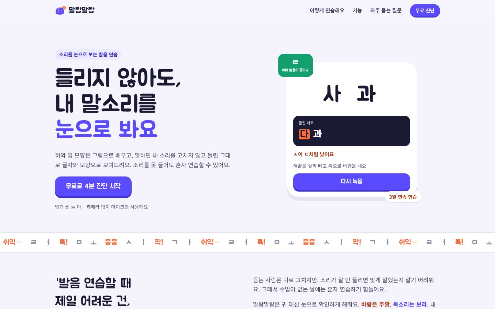

## 화면

| 오늘의 학습 | 소리 레슨 | 따라 말하기 (모음 지도) | 결과 |
|:---:|:---:|:---:|:---:|
| 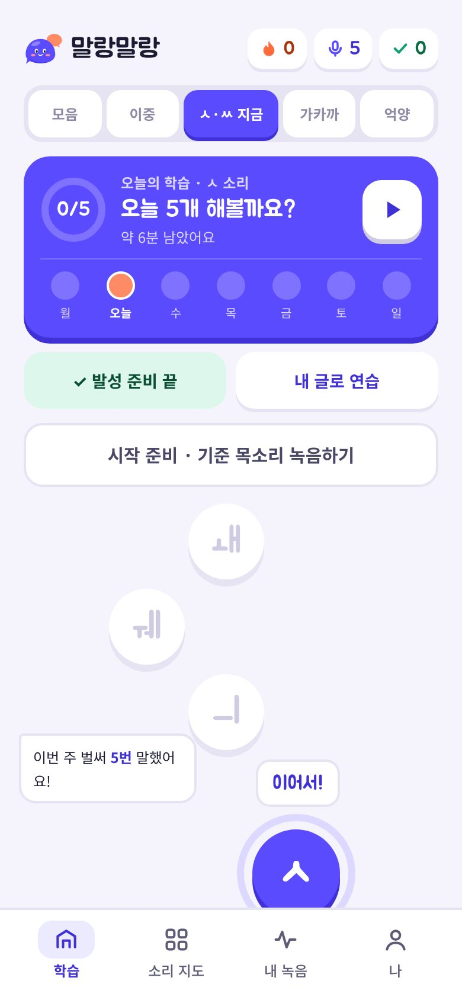 | 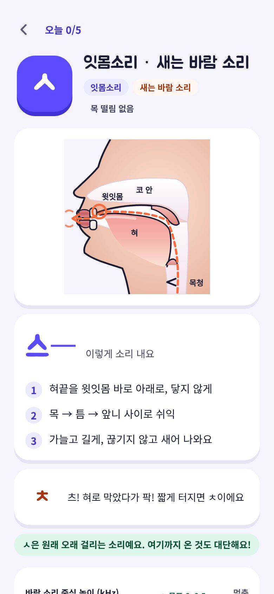 | 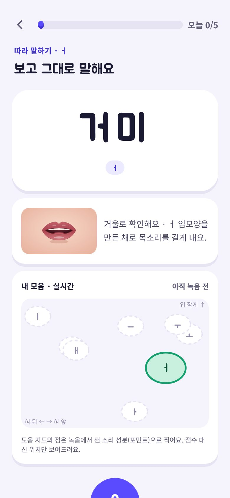 | 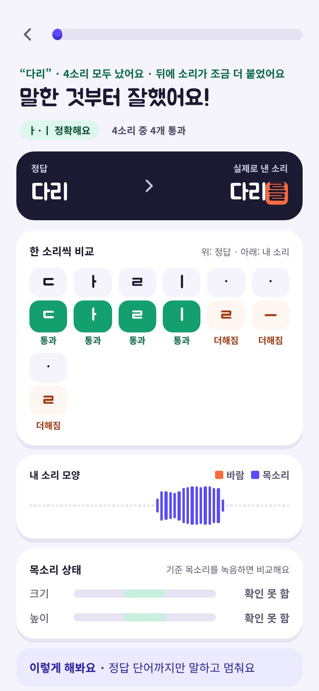 |
| **발성 · 억양** | **ㅅ 쉬익 미터** | **모음 입모양** | **내 글로 연습 결과** |
| 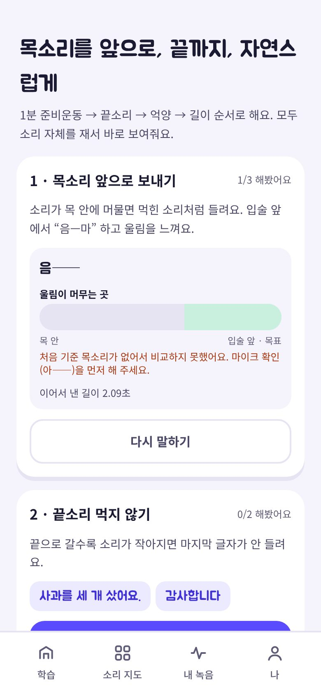 | 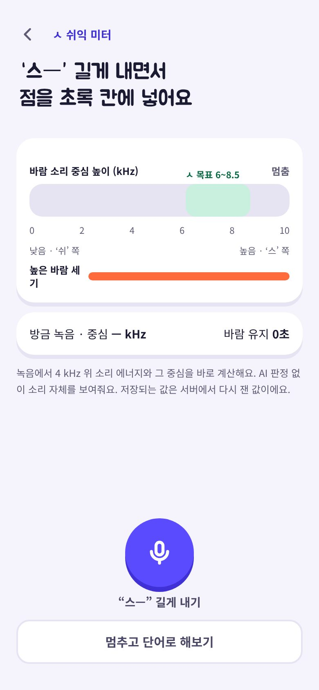 | 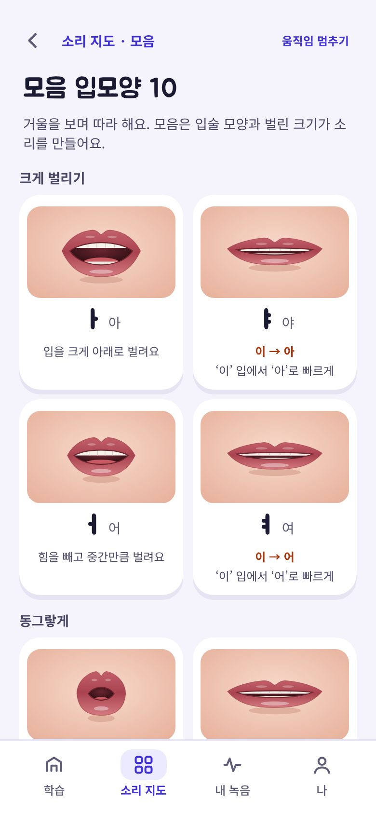 | 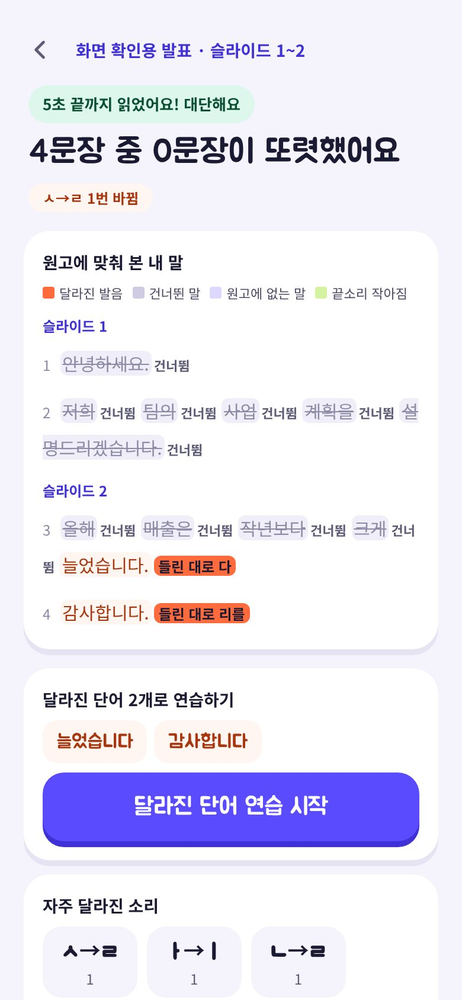 |

넓은 화면에서는 왼쪽 메뉴와 대시보드형 배치로 바뀐다.

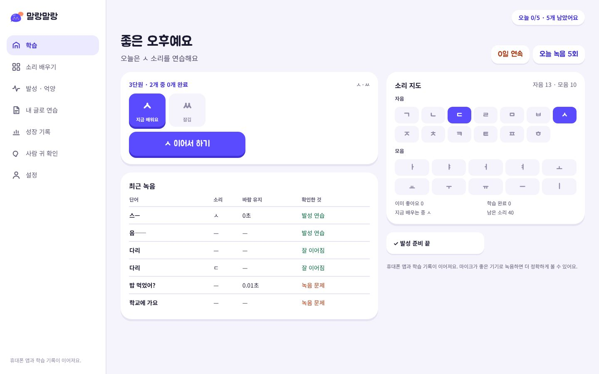
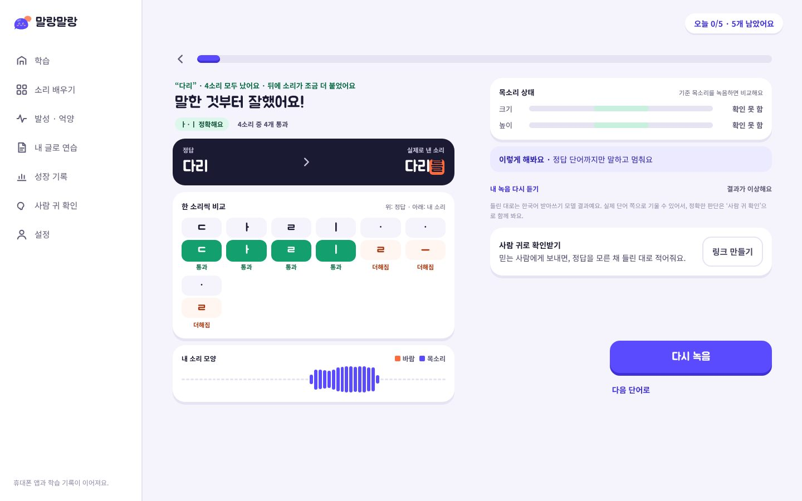

> 화면의 녹음·분석 결과는 실제로 녹음해서 분석한 값이다 (테스트 계정).

## 구조

```
Speech_Therapy/
├── frontend/        Next.js 14 · React · TypeScript · Tailwind · React Query · Zustand
├── backend/         NestJS 10 · Prisma 7 · PostgreSQL · JWT · Swagger
├── analyzer/        Python 분석 워커 · 한국어 음성 인식(sherpa-onnx) · Praat 측정 · 표준발음법 엔진
├── database/        마이그레이션 SQL 생성기
├── docs/            requirements · architecture · database-erd · api-specification · frontend/backend-structure · deployment
├── infrastructure/  dev-up.sh (Docker 없이 실행)
├── models/          (내려받는 음성 인식 모델, git 제외)
└── docker-compose.yml
```

## 실행
```bash
cp .env.example .env    # 값 채우기 (docs/deployment.md)
docker compose --env-file .env up --build
# 웹 http://localhost:3000 · API http://localhost:4000/api · Swagger http://localhost:4000/api/docs
```

## 테스트
```bash
cd analyzer && ASR_MODEL_DIR=../models/sherpa-onnx-zipformer-korean-2024-06-24 .venv/bin/python -m pytest -q   # 48개 (모델 없으면 3개 건너뜀)
cd backend && npx jest && npm run test:e2e                                                                       # 단위 17 · 통합 32
cd frontend && npx vitest run                                                                                    # 9개
```

## 동작하는 것 (실제 DB·실제 분석으로 확인)
- **첫 실행**: 랜딩(출시 소식 신청) · 스플래시·환영 · 튜토리얼 6단계(‘아——’ 녹음을 기기에 두었다가 가입 뒤 기준 목소리로 이어씀) · 약관·개인정보
- **계정**: 아이디 가입·로그인(5회 잠금)·토큰 회전·게스트로 진단 후 가입 시 기록 이어받기 · 14세 미만 보호자 동의 · 비밀번호 바꾸기 · 간편 로그인 연결 · **이메일 인증 → 이메일로 비밀번호 재설정**(30분·한 번만, 계정이 있는지 알려주지 않음, 바꾸면 다른 기기 로그아웃 — 로컬 SMTP 서버로 실제 메일 왕복 확인)
- **시작**: 마이크 권한·거부 안내(웹은 QR로 휴대폰 열기) → 주변 소음·기준 목소리 → 첫 진단 글자 23·단어 8·문장 3 → 이미 좋은 소리 클리어 · 단계별 맞게 낸 개수 → 연습 순서 → 하루 목표·알림
- **매일 학습**: 홈 학습 경로(넓은 화면은 대시보드: 단원 카드·최근 녹음 표·소리 지도) · 1분 발성 준비 · 새 소리 기초선 3단어×3번(피드백 없음) · 레슨(단면도·모음 입모양 애니메이션·헷갈리는 모음 비교·ㅅ 실시간 쉬익 미터·진동으로 느끼기) · 따라 말하기(모음은 실시간 모음 지도 점) · 결과(한 소리씩 비교·확실하지 않음 설명·소리 모양 막대·모음 위치·사람 귀 링크) · 완료·일기·내일 할 것 · 복습 3개 · 일주일 체크(기초선 vs 지금) · 이틀 넘게 쉬면 ‘다시 만나서 반가워요’(목표 줄이기)
- **발성·억양**: 목소리 앞으로(처음 기준 대비 울림 위치·거리) · 끝소리(글자별 크기) · 묻는 말 끝 올리기(높이 곡선) · 길게 끌지 않기(글자 길이·빠르기) · ㅅ 쉬익 미터(kHz)
- **내 글로 연습**: PPT·PDF·사진(OCR)·붙여넣기 → 슬라이드 범위 → 읽으면서 녹음 또는 파일 올리기 → 문장마다 달라진 발음·건너뜀·원고에 없는 말·끝소리·빠르기 흐름 → 달라진 단어로 바로 연습
- **성장 기록**: 처음 vs 지금 자음·단어 맞게 낸 수, ㅅ 기초선 vs 연습 후, 모음 삼각형(ㅣ·ㅏ·ㅜ) 넓이, 기록 내보내기 zip
- **사람 귀 확인**: 받아쓰기 링크(7일, 무작위 순서, 정답 비공개, QR) → 로그인 없는 듣는 사람 화면 → 사람 귀 vs 앱 · 듣는 사람별
- **설정**: 목표·알림(웹 푸시 구독·시험 알림)·진동·큰 글자 · 내 목소리에 맞추기 · 연구 모드·심의 번호 · 녹음 원본 보관 30일/90일/1년/내가 지울 때까지 · 녹음 지우기·계정 삭제
- **인터넷 끊김**: 녹음을 기기(IndexedDB)에 보관 → 연결되면 자동 업로드(같은 녹음 두 번 안 받음) · 보관 중 목록 · 서비스 워커가 설치 때 화면 79개와 JS·CSS를 미리 받고, 로그인 뒤 소리 40개 설명·발성 문항을 받아 둠 → **한 번도 안 열어 본** 소리 지도·레슨·발성 화면도 인터넷 없이 열림(브라우저로 확인)
- **소리 단위 교차 확인**: 다국어 음소 인식 모델 Allosaurus(uni2005)를 torch 없이 numpy로 다시 구현해서, 목표 발음에 맞춰 정렬(CTC 강제 정렬)한 뒤 소리마다 짝 소리와 비교. 받아쓰기는 ‘같음’인데 소리 단위로는 짝 소리로 뚜렷하면 ‘확실하지 않음’ + 결과 화면에 이유. 3초 녹음에 약 0.1초
- **받아쓰기 교차 확인**: 받아쓰기가 ㅅ·ㅆ을 맞게 들었다고 해도, 녹음에서 직접 잰 바람 소리가 거의 없거나(막힌 소리) 중심이 4kHz보다 낮으면(‘쉬’ 쪽) ‘같음’을 ‘확실하지 않음’으로 바꾸고 결과 화면에 이유를 보여줌
- **관리자**: 단어·문장 등록·수정·삭제·검토 승인, 신고 확인, 통계
- 녹음 AES-256-GCM 암호화 저장, 보관 기간 지나면 원본 자동 삭제
- 화면 확인: 휴대폰(390px)·넓은 화면(1440px)에서 새 화면 33개 모두 열어 콘솔 오류 없음, 가짜 마이크로 발성·기초선·직접 정한 단어·받아쓰기 링크 흐름까지 실제 녹음→분석 확인

## 아직 안 된 것 (솔직하게)
| 항목 | 상태 |
|---|---|
| 음소 판정 | 받아쓰기(단어 단위)가 중심이고, **소리 단위 모델(Allosaurus)로 교차 확인**만 한다. 이 모델은 한국어로 학습하지 않아서 판정을 뒤집지 않고 ‘확실하지 않음’으로 보류하는 데만 씀. 보는 짝: 낱말 중간 ㄱ↔ㅋ·ㄷ↔ㅌ·ㅂ↔ㅍ, ㅅ↔ㄷ·ㅌ. **ㄱ↔ㄲ(된소리)·모음·ㄹ↔ㄴ·낱말 첫소리 평음/격음은 못 봄**. 바른 한국어 녹음 34소리에서 잘못 걸림 0, 목표를 바꿔 흉내 낸 12건 중 9건 잡음 (표본이 작음) |
| 내 목소리에 맞추기 | 받아쓰기 모델 재학습이 **아님**. 맞게 낸 모음(모음마다 3번 이상)으로 모음 지도 목표 칸을 옮기는 개인 보정. 결과 화면과 실시간 모음 지도 모두 이 칸을 씀 |
| 카카오·구글 로그인 | 코드 완료, 키가 없어 실제 왕복은 미시험 |
| 웹 푸시 | 구독·발송 코드 완료, 실제 기기 도착은 미시험. 아이폰은 홈 화면에 추가한 앱에서만 됨 |
| 이메일 | 실제 메일 회사(SMTP) 계정으로는 미시험 — 로컬 SMTP 서버로만 왕복 확인. 문자(SMS) 인증은 없음 |
| 진동 | `navigator.vibrate` 지원 브라우저(안드로이드)만. 아이폰·데스크톱은 기호만 움직임 |
| 오프라인 | 진단·연습 녹음 화면은 문항을 서버에서 받아야 해서 처음엔 인터넷 필요(녹음 자체는 끊겨도 보관). 글꼴은 쓸 때 저장해서, 처음 보는 글자는 기본 글꼴로 보일 수 있음 |
| 내 글로 연습 | 긴 녹음은 받아쓰기 정확도가 떨어질 수 있음. 손글씨 사진은 잘 못 읽음 |
| Docker · 서버 | `docker-compose.prod.yml`(Caddy HTTPS) · `infrastructure/server/setup.sh`(Oracle 무료 서버 한 번에 세우기) 작성. 이 환경에 Docker가 없어 실제로 띄워 보지는 못함 → [배포 문서](docs/deployment.md) |
| 문항 검토 | 보드 확정본도 언어재활사 검토 전. 앱이 채운 단어는 '검토 전' |

## 가져다 쓴 모델·라이선스
| 이름 | 쓰는 곳 | 라이선스 |
|---|---|---|
| [sherpa-onnx](https://github.com/k2-fsa/sherpa-onnx) · Zipformer 한국어 모델 | 받아쓰기 | Apache-2.0 |
| [Allosaurus](https://github.com/xinjli/allosaurus) uni2005 | 소리 단위 교차 확인 (`analyzer/malang_analyzer/phones.py` 는 이 코드의 특징 추출·모델 구조를 numpy로 옮긴 것) | **GPL-3.0** |
| [Praat](https://www.fon.hum.uva.nl/praat/) · parselmouth | 음높이·포먼트 | GPL-3.0 |
| Tesseract (kor) | 사진 원고 글자 읽기 | Apache-2.0 |

GPL-3.0 구성 요소가 있어서, 분석 워커를 배포할 때는 GPL-3.0 조건(소스 공개 등)을 따라야 한다. 이 저장소에는 아직 라이선스 파일이 없다.
