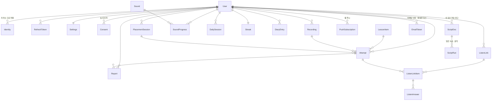

# 데이터베이스 ERD

정의 원본: `backend/prisma/schema.prisma` · 마이그레이션: `backend/prisma/migrations/`

## 표 설명

| 표 | 담는 것 | 디자인 근거 |
|---|---|---|
| User | 계정, 역할(LEARNER/ADMIN), 게스트 여부, 로그인 잠금, 기준 목소리 | Login, SignUp, MicCheck |
| Identity | 카카오·구글 계정 연결 | Login |
| RefreshToken | 리프레시 토큰 해시, 회전 묶음(family) | — (보안) |
| Settings | 하루 목표, 알림, 진동, 글자 크기, 녹음 보관 기간 | GoalSetup, Settings |
| Consent | 약관·개인정보·녹음·학습·연구·보호자 동의 (언제, 어떤 버전) | TechSpec 6장 |
| Sound | 자음·모음 40개, 소리 나는 곳·방법·목 떨림, 레슨 설명 | SoundMap, Learn |
| LessonItem | 글자·단어·문장·문단, 표준 발음, 보는 소리, 진단 여부, 기초선 단어, 검토 상태 | Stimuli |
| Recording | 암호화된 녹음 파일 위치, 길이, 만료일 | TechSpec 6장 |
| PlacementSession | 첫 진단 한 번, 결과 요약 | Placement* |
| Attempt | 녹음 한 번의 분석: 상태, 녹음 문제, 들린 대로, 결과 JSON, 모델 버전 | Record, Result |
| SoundProgress | 소리별 상태(잠김/배우는 중/배움/이미 좋음), 진단 통과 점 3개, 연속 실패 | Main, PlacementResult, HelpSheet |
| DailySession | 날짜별 목표·완료·녹음 수 | Main, Complete |
| Streak | 연속 기록·최고 기록 | Main, StreakLost |
| DiaryEntry | 한 줄 일기 | Diary |
| ListenLink / Item / Answer | 받아쓰기 링크, 들려줄 녹음, 듣는 사람 답과 비교 결과 | ListenerShare, WebListen |
| Report | "결과가 이상해요" 신고 | Uncertain |
| PushSubscription | 기기별 웹 푸시 구독(endpoint·키) | Settings 알림 |
| NewsletterSignup | 랜딩 출시 소식 신청 이메일 | Landing |
| ScriptDoc | 올린 원고(pptx·pdf·사진·글), 슬라이드별 글, 글 뽑기 상태 | MyScript |
| EmailToken | 이메일 인증·비밀번호 재설정 링크(토큰은 해시만, 만료·사용 시각) | — (계정 되찾기) |
| ScriptRun | 원고를 읽은 녹음(암호화) · 슬라이드 범위 · 분석 결과 JSON | MyScriptResult |

추가 열: `User.email · emailVerifiedAt`(인증한 주소만 재설정에 씀), `User.calibration`(내 목소리에 맞춘 모음 목표), `Settings.personalModel · researchMode · researchAudio · irbNumber · retentionDays(0=내가 지울 때까지)`,
`LessonItem.exercise · intonation · baselineFor`, `Attempt.clientId`(오프라인 재전송 중복 방지, `(userId, clientId)` 유니크) · `appliedAt`,
`SoundProgress.baselineDoneAt · weeklyDoneAt`. 녹음 맥락(`Attempt.context`): MIC_CHECK · PLACEMENT · PRACTICE · BASELINE · WEEKLY · REVIEW · EXERCISE.

## 무결성·권한
- 모든 사용자 데이터는 `User`에 `onDelete: Cascade` → 계정 삭제 시 함께 삭제. 녹음 파일은 서비스가 먼저 지운다.
- `LessonItem` 삭제 시 과거 `Attempt`는 `itemId = null`로 남고 `targetText`·`targetPronunciation`을 자체 보관(기록 보존).
- 유니크: `loginId`, `(provider, providerUserId)`, `(userId, date)` 일일·일기, `ListenLink.code`.
- 생성·수정 시각: 모든 주요 표에 `createdAt`, 변경되는 표에 `updatedAt`.

## 아동 개인정보·보관
- 만 14세 미만: 가입 시 `Consent(type=GUARDIAN)`에 보호자 이름·연락처 저장, 없으면 가입 거부.
- 녹음 원본: `Recording.expiresAt = 만든 시각 + Settings.retentionDays`. 지나면 파일 삭제 + `deletedAt` 기록. `Attempt.result`(글자·측정값)는 남는다.
- 듣는 사람 답은 개인 식별 정보 없이 저장(이름·연락처 받지 않음).
